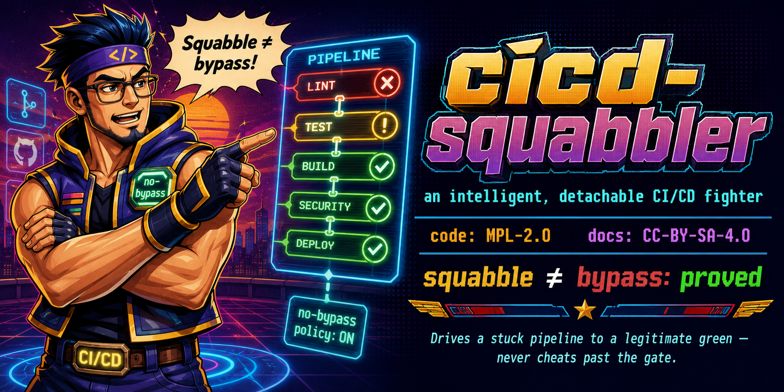

// SPDX-License-Identifier: CC-BY-SA-4.0
// Copyright (c) 2026 Jonathan D.A. Jewell <j.d.a.jewell@open.ac.uk>
= cicd-squabbler — an intelligent, detachable CI/CD fighter
:toc: preamble
:icons: font

image:https://img.shields.io/badge/License-MPL_2.0-blue.svg[code: MPL-2.0]
image:https://img.shields.io/badge/docs-CC--BY--SA--4.0-green.svg[docs: CC-BY-SA-4.0]
image:https://img.shields.io/badge/invariant-SPARK--proved-success.svg[squabble≠bypass: proved]

[.lead]
A standalone, per-repo CI/CD fighter that drives a stuck pipeline to a
*legitimate* green — or improves red→yellow, or fails and hands the human a
structured report. It *wins* the gate; it never cheats past it.

NOTE: Status — *v0.1 in active development (updated 2026-10-28).* The engine and
its formal invariant are real and verified (see below); live gate fetch via `gh`
landed in #6; `squabble fight` (classify each red as self-win | escalate |
assign-owner), the `squabble-app` loopback HTTP backend, and the boj-server
expert summoning (`--summon`, feature `boj`) landed in #13. `squabble fight
--apply` now *enacts* the first appliable self-win — stripping an `on.*.paths`
trigger filter that strands a required check — by writing the workflow file
(propose remains the default; `--apply` never commits, pushes, or re-runs CI).
The fetch reads *both* gate surfaces — branch rulesets AND classic branch
protection (#100) — and probes the repository's Actions permissions whenever a
required context refuses to start, so a `STARTUP_FAILURE` is attributed to the
posture that caused it rather than to the reusable's owner or a security scan
(#15). Still open: applying the other self-wins (required-context reconcile,
reusable-workflow re-pin — these need the GitHub ruleset API / a target SHA) and
the GitHub App *webhook* leg (pending the owner's hosting decision). Zero-job
`startup_failure` runs — no job, therefore no check run, therefore nothing in a
PR check list — are now first-class: `squabble zero-job` **attempts to attribute**
each observed run to a moved coordinate or an allow-list gap, and reports
`Unattributed` — with the probe failure quoted, and exit `4` — when the evidence
does not support a class; `squabble chains` compares
canonical upstream names through REST so a move is named *before* a run proves
it. Both are diagnosis only; `squabble ≠ bypass` still holds. See
`docs/CHARTER.adoc` for the design and open owner decisions.

== Chains: cross-repo CI dependencies (read-only)

`squabble chains` maps which repos' CI depends on which, through reusable
workflows and pinned actions. Nothing is written anywhere.

[source,sh]
----
squabble chains . ../standards gh:hyperpolymath/typed-wasm --follow 1
----

* *Blocking* (exit 4): dependency cycles, and dead upstreams. A deleted action
  repo produces no check run at all, so the board reads green.
* *Warnings*: diamonds (one repo's CI receives an upstream at two pins, one
  of them via a reusable workflow), pin skew across repos, tag/branch pins,
  and **moved upstreams** (see below).
* It also prints an upstreams-first landing order and the longest chain.

Every upstream coordinate is resolved through REST with redirects followed, and
its canonical `full_name` is compared with the name as written — names, never
pins. A difference is reported as a moved upstream: a reusable coordinate under
a renamed/transferred owner can die as a zero-job `startup_failure` ("workflow
was not found") that no PR check list shows, so it is named *before* CI goes
quiet. It stays a warning while the redirect still works (that is a risk, not an
observed failure); `squabble zero-job` is what turns an observed failure into a
blocking finding. The same canonicalisation groups pin skew, so the old and new
spellings of one upstream cannot hide a split. `--no-canonical` skips the REST
reads and says so — a deliberate blind spot, not a clean bill.

An upstream that was never probed is listed on the frontier, not assumed
healthy. See `docs/proposals/squabble-modes-and-app-layer.adoc` for where
this is heading: upstream conformance, custodian rulesets, and the app-aware
layer.

== Zero-job startup failures: the CI that never reports

Some workflows fail *before any job exists*. GitHub creates no check run, the PR
check list stays tidy, and a required context is simply absent. Two first-class
classes are modelled, each with its own move:

[cols="2,1,2"]
|===
| Class | Move | What it means

| *moved coordinate*
| `RepointToCanonical`
| A reusable coordinate names an owner/repo that was renamed or transferred.
  Repoint to the canonical name **carrying the same pin** — repointing is not
  re-pinning, and no pin is ever resolved on the way.

| *allow-list admission required*
| `AllowListAdmissionRequired`
| The coordinate (or its canonical target) is refused by the caller's
  `allowed_actions=selected` allow-list. The report names the exact minimal
  `owner/repo@*` pattern to admit; no workflow edit can admit *this coordinate*
  (a different coordinate may already be admitted, and under `verified_allowed`
  an uncovered action is reported `Unattributed` rather than refused, because
  creator status cannot be resolved here).
|===

[source,sh]
----
squabble zero-job . --limit 30        # attribute the latest zero-job runs
squabble zero-job . --limit 30 --json # the same, machine-readable
----

Per run it reports the repo, the workflow, the coordinate **as written**, the
canonical target, and the required allow-list pattern — plus the sequencing: fix
the repoint first, then admit the canonical pattern if the run is still refused.
Exit `4` means zero-job runs were observed, attributed or not: a run it cannot
attribute is still a run that never reported. Exit `0` speaks only for the
scanned window.

`zero-job` is *outside* `squabble-contract/1.0.0`: that revision's surface stays
at four subcommands, and nothing here adds meaning to it. Like `chains`, the
command is read-only and writes nothing, so its absence from the pinned
contract costs a consumer nothing.

Both moves only let a check *start*. Neither drops a required context, weakens a
check, nor edits settings: `squabble ≠ bypass` holds, and nothing here is a
green. A missing or skipped check cannot be made green by a diagnosis.

== Rust deductive verification (Creusot)

The estate requires its Rust to carry verification obligations, the twin of the
SPARK proofs. `verification/squabble-creusot` states the engine's load-bearing
invariants — acceptance ⇔ every requirement satisfied and the set non-empty, a
skip is not evidence, no diagnosis is a green, admission is refused exactly when
it is required, a repoint carries the pin verbatim — to
https://github.com/creusot-rs/creusot[Creusot], and mirrors them as ordinary
`#[test]`s against the real code so drift is caught on stable Rust.

[source,sh]
----
just verify-status    # which toolchain and prover are present
just verify-install   # stable + Creusot's pinned nightly + Creusot itself
just verify-mirror    # stable Rust: the model vs the real engine
just verify-creusot   # the prover: discharge the obligations
----

**Stated, not proved.** No obligation has been discharged, and this repository's
own `Rust CI` currently ends as a zero-job `startup_failure`, so CI has not
compiled the workspace either. `.github/workflows/creusot.yml` calls the estate's
`creusot-gate.yml`, which fails a claim of proof with no contracts behind it and
reports *no proof performed* rather than a verdict when the prover cannot be
shown to work. Details and the licence note: `docs/CREUSOT.adoc`.

== Downstream integration contracts (pinned, immutable revisions)

`contracts/` publishes two contracts that other repositories integrate against.
Both are consumed by *revision id plus a sha256 manifest*, never by a branch:

[cols="1,2"]
|===
| `contracts/squabble` — `squabble-contract/1.0.0`
| The read-only CI invocation: which subcommands are in contract, the six read
  permissions the gate needs (and the `administration: read` an App token must
  supply), the machine-readable gate/verdict documents, the exit semantics, and
  the decision procedure for `legitimate_green` — a commit-bound envelope whose
  *every* required check ran and passed. Missing, skipped, cancelled, pending and
  failing required checks each have a negative fixture proving they cannot reach
  it.

| `contracts/proven-tests` — `proven-tests-evidence/1.0.0`
| The evidence format a Rust repository submits to Proven-Tests: real executed
  tests with a log digest, example/property/proof told apart, coverage derived
  only from executed non-debt passes, the required Idris2 toolchain for the
  framework itself (not for submitting), and a minimal downstream Rust fixture.
|===

[source,sh]
----
just contract-test                                    # both conformance suites
just contract-pin squabble 1.0.0                      # verify a pin as a consumer does
bash contracts/bin/verify-pin.sh proven-tests 1.0.0
----

Nothing in either contract writes: no merges, no re-runs, no edits, no admin
overrides. The consumer audit refuses a workflow that grants a write scope, pins
to a moving ref, masks a gate step, or calls `fight --apply`.

== Core principle: squabble ≠ bypass

Every "green" the squabbler declares is backed by the gate's *own* required
check passing legitimately — never by an admin override, an `enforce_admins`
toggle, or removal/rename-away of a required context. An admin-merge cheats past
the gate; a squabble *wins* it.

This is not a code-review promise. It is a *machine-checked invariant*: the
SPARK package in `spark/` proves that the only transition into `Green` is "a
required check actually ran and passed" — dropping the required set, renaming a
check away, or any override are provably *not* paths to green.

== What's in the box

[cols="1,3"]
|===
| `crates/squabble-core` | The fight engine. Pure, detachable, no hypatia/estate dependency — `diagnose → propose move → apply → verify-satisfied`. The valuable reusable part.
| `crates/squabble-fight`| The shared host brain: a2ml ecosystem-context reader + workflow ground-truth + the fight planner. One planner for the CLI and the App, so they cannot drift.
| `crates/squabble-cli`  | `squabble` — runs locally or as a CI step. `fetch`, `diagnose`, and `fight` (with `--summon` under the `boj` feature to put expert verdicts on the report, and `--apply` to enact the path-filter self-win by editing the workflow — no commit/push).
| `crates/squabble-app`  | The loopback HTTP backend (axum, `127.0.0.1:7741`): serves the shared planner to the boj-server `cicd-squabbler-mcp` cartridge. The GitHub App *webhook* leg (trigger button + octocrab) is still to come — no webhook route is registered.
| `crates/squabble-forge`| Forge access: GitHub GraphQL via `gh api graphql`, batched, validated against a committed schema snapshot. REST where GraphQL has no equivalent — notably `repos/{o}/{n}` for canonical `full_name` resolution (redirects followed, names compared).
| `spark/`               | The formal heart. `Gate_Machine` + the proved theorem `green ⇔ (non-empty ∧ all passed)`.
| `verification/squabble-creusot` | The Rust twin of `spark/`: Creusot contracts for the same invariants, plus a stable-Rust mirror that fails if the engine drifts from them. **Stated, not proved** — no obligation has been discharged yet. See `docs/CREUSOT.adoc`.
|===

== Verify it yourself

[source,sh]
----
just test    # 7 engine tests pass
just prove   # gnatprove: postcondition proved (squabble ≠ bypass)
just demo    # diagnose a stale-required-context deadlock
----

== The v0.1 fight playbook (gate-deadlock class only)

Mined from the 2026-06-22 `rsr-template-repo` lockdown (effectively a manual
squabbler run). Every move *satisfies* the gate:

. *Stale required-context* — reconcile the required name to the real emitted name.
. *Path-filter deadlock* — inject the documented job-level pass-through.
. *Reusable-workflow pin drift* — re-pin a stale/broken SHA to current.
. *Modify/delete & rebase conflicts* — resolve and re-run.
. *Check-name ground-truthing* — the shared substrate for moves 1 and 2.
. *Licence-policy drift* — doctrine-constrained: adding a missing canonical
  `LICENSES/` text is authoring (may apply); rewriting an existing file's SPDX
  header is relicensing (flag, owner-only — never edit).
. *Non-functional gate* — the required check's own script fails unconditionally
  (cannot be won from the PR side; mined from `hypatia#566`): recognise, stop
  re-diagnosing, escalate with evidence.
. *Actions-policy `startup_failure` deadlock* (issue #15) — the repository's
  own posture refuses to start a required check: an empty/lacking `selected`
  allowlist (`ReconcileActionsPolicy` / `SetActionsAllowedAll` — estate
  posture of record is `allowed_actions=all` with `sha_pinning_required=true`
  KEPT), or a tag-pinned `uses:` under enforced SHA pinning
  (`PinWorkflowActions`). The fetch probes `actions/permissions` whenever a
  required context resolves to `STARTUP_FAILURE`, so the fight proposes the
  settings/pin move instead of mis-attributing to the reusable's owner or a
  security scan. These moves only let a required check *start*; none weakens
  the gate.
. *Zero-job `startup_failure`* — a workflow that dies before any job exists, so
  no check run is created and no PR check list shows it. Two distinct classes:
  a *moved coordinate* (reusable owner renamed/transferred) →
  `RepointToCanonical` **with the same pin**; and *allow-list admission
  required* (canonical coordinate refused by the caller's `selected` allow-list)
  → `AllowListAdmissionRequired` naming the exact `owner/repo@*` pattern.
  `squabble chains` resolves every upstream's canonical `full_name` and flags
  moved upstreams and canonical-grouped pin skew before a run proves it;
  `squabble zero-job` reports attribution per observed zero-job run. Diagnosis
  and sequencing only — neither move makes anything green.

Red→green *code* fixes are deliberately *out of scope* for v0.1: "fixing" a
failing test by weakening it would violate squabble ≠ bypass.

== Licensing

Code MPL-2.0; documentation CC-BY-SA-4.0. An RSR-shaped repository of the
hyperpolymath estate.
